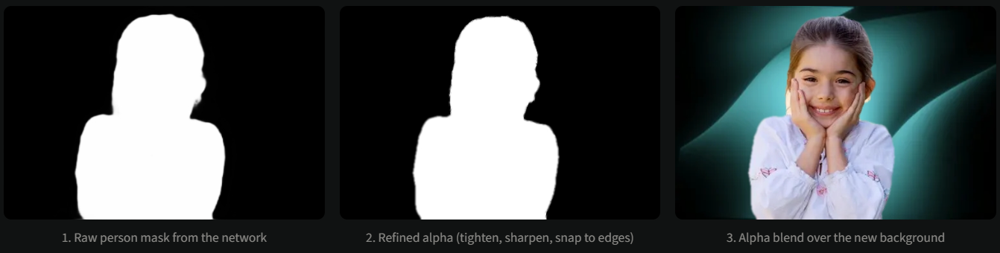
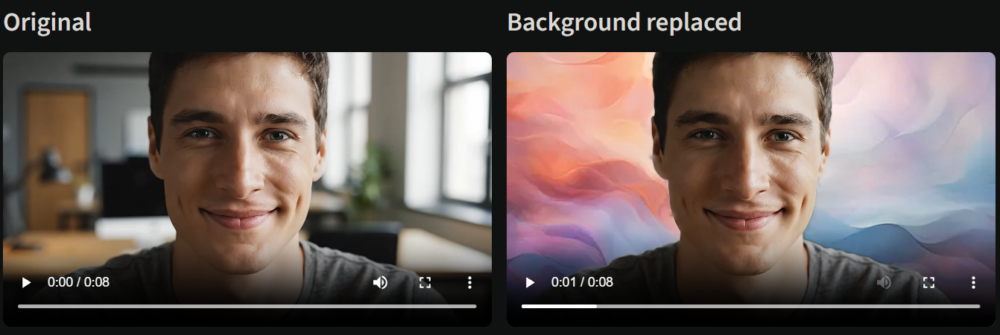
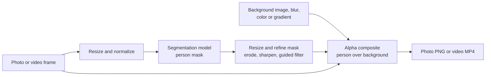

<div align="center">

# 🎬 Photo & Video Background Changer

**Replace the background in a photo or recorded video with any image, powered by a fine-tuned U-Net person-segmentation model.**

[](https://background-changer.streamlit.app/)
[](https://huggingface.co/rufaidakassem/unet_background_segmentation)
[](https://www.python.org/)
[](https://pytorch.org/)
[](LICENSE)

[**Try the app**](https://background-changer.streamlit.app/) · [**Get the model**](https://huggingface.co/rufaidakassem/unet_background_segmentation) · [**Results**](#-results) · [**Train your own**](#-train-the-segmentation-model)

</div>

<p align="center">
  
</p>
<p align="center"><sub>Raw network mask → refined alpha → final composite</sub></p>

---

## ✨ Features

- 📷 **Photo and video**: replace the background of a photo (download as PNG) or a recorded video (download as MP4).
- 🖼️ **Flexible backgrounds**: your own image, a blur of the original, a solid color, or a gradient.
- 🧍 **Person segmentation**: a fine-tuned U-Net (ResNet-34 encoder) separates the person from the background. DeepLabV3 (ResNet-50) is also supported.
- 🪄 **Edge-aware refinement**: the mask is eroded, sharpened with a smooth transition, and snapped to real image edges with a guided filter.
- 🎚️ **Live controls**: sliders for edge tightening, softness and hair-detail radius update the result instantly.
- 🔍 **"Under the hood" view**: see the raw mask, the refined alpha and the final blend side by side.
- 📊 **Progress and timing**: per-photo segmentation time, and a time-remaining estimate for videos.
- ⚡ **GPU when available**: uses CUDA if present, otherwise falls back to CPU.

<p align="center">
  
</p>

## 🧠 How it works



For every photo or video frame the app:

1. Resizes it to the model's input size (384×384 for U-Net, 256×256 for DeepLabV3) and normalizes it with ImageNet statistics.
2. Runs the TorchScript model and applies a sigmoid to get a per-pixel person probability.
3. Resizes the mask to the frame, erodes it slightly, sharpens its transition, and refines it with a guided filter so the edge follows the photo's real edges.
4. Blends the frame and the background: `output = frame × alpha + background × (1 − alpha)`.

### Model details

| Item           | Value                                                                                                                      |
| -------------- | -------------------------------------------------------------------------------------------------------------------------- |
| Architecture   | U-Net with an ImageNet-pretrained ResNet-34 encoder (default); DeepLabV3 with a ResNet-50 backbone is also supported       |
| Task           | Binary segmentation (person vs. background)                                                                                |
| Input size     | U-Net: 384 × 384; DeepLabV3: 256 × 256; both use ImageNet mean/std normalization                                           |
| Loss           | U-Net: BCE + Dice; DeepLabV3: `BCEWithLogitsLoss`                                                                          |
| Optimizer      | Adam, learning rate `1e-4`                                                                                                 |
| Training setup | 85/15 train/validation split, up to 15 epochs, early stopping (patience 3)                                                |
| Export         | Best validation checkpoint saved as a TorchScript file                                                                    |
| Dataset        | [Supervisely filtered person segmentation](https://www.kaggle.com/datasets/tapakah68/supervisely-filtered-segmentation-person-dataset) |

## 📈 Results

U-Net (ResNet-34), best checkpoint (epoch 10, early stopping at epoch 13):

| Metric                  | Validation | Training |
| ----------------------- | ---------- | -------- |
| IoU                     | **0.930**  | 0.967    |
| Dice                    | **0.962**  | n/a      |
| BCE + Dice loss         | 0.124      | 0.056    |

Measured on 399 held-out images at 384×384 with a 0.5 threshold, on the raw network mask before edge refinement. The gap between training and validation IoU shows mild overfitting, so data augmentation and a learning-rate schedule are the natural next steps. These metrics do not capture hair quality, which is why the app exposes the refinement controls.

---

## ⚠️ Limitations

- The processed video **does not include the original audio**.
- The hosted demo limits videos to **20 seconds**, and **CPU processing can be slow**. Use a CUDA-enabled PyTorch build if you have a GPU.
- Each frame is segmented **independently** (no temporal smoothing), so edges can shimmer slightly on fast motion or busy scenes.
- Against a very dark replacement background, a faint light fringe can appear around hair, because original background colors blend into the soft edge.
- The model is trained for **people only**; other foreground objects are treated as background.
- If a video can't be decoded, try re-encoding it as an **MP4 (H.264)**.

---

## 🚀 Quick start

### 1. Clone and install

```bash
git clone https://github.com/Rufaida-Kassem/background_changer.git
cd background_changer
```

Install PyTorch for your platform first (choose a CUDA-enabled build if your machine supports it, and install a compatible `torchvision` alongside it), then the remaining requirements:

```bash
python -m pip install torch torchvision
python -m pip install -r requirements.txt
```

For videos that play in every browser, install [ffmpeg](https://ffmpeg.org/) as well. The app re-encodes the output to H.264 when it is available.

### 2. Configure the model (optional)

The app uses U-Net by default. It loads `model/unet_background_segmentation.pt` when that local file exists; otherwise it downloads `unet_background_segmentation.pt` from [rufaidakassem/unet_background_segmentation](https://huggingface.co/rufaidakassem/unet_background_segmentation). Model files are excluded from Git.

- Set `MODEL_REPO_ID` to use a different Hugging Face repository containing the selected model's filename.
- To use DeepLabV3 instead, set `MODEL_TYPE=deeplabv3` before launching (in PowerShell: `$env:MODEL_TYPE = "deeplabv3"`). The DeepLabV3 model is hosted at [rufaidakassem/deeplabv3_background_segmentation](https://huggingface.co/rufaidakassem/deeplabv3_background_segmentation).

### 3. Run the app

```bash
python -m streamlit run src/app.py
```

Open the local URL printed by Streamlit. Pick a sample or upload your own photo or video, choose a background, and adjust the edge-refinement sliders in the sidebar.

Sample photos and backgrounds are optional: put images in `assets/samples/` and `assets/backgrounds/` and they appear in the app automatically.

### ☁️ Deploying on Streamlit Community Cloud

No secrets are needed for the default U-Net deployment. The `packages.txt` file installs ffmpeg so processed videos play in the browser. To select the hosted DeepLabV3 model instead, add:

```toml
MODEL_TYPE = "deeplabv3"
MODEL_REPO_ID = "rufaidakassem/deeplabv3_background_segmentation"
```

---

## 🏋️ Train the segmentation model

Both models were trained on the [Supervisely filtered person segmentation dataset](https://www.kaggle.com/datasets/tapakah68/supervisely-filtered-segmentation-person-dataset). Download and extract it locally; it is not included in this repository.

### U-Net (default)

The U-Net is trained in [`notebook/background-changer-unet.ipynb`](notebook/background-changer-unet.ipynb) with [`segmentation_models_pytorch`](https://github.com/qubvel-org/segmentation_models.pytorch): a ResNet-34 encoder pretrained on ImageNet, BCE + Dice loss, per-epoch validation IoU and Dice, early stopping, and TorchScript export to `unet_background_segmentation.pt`.

### DeepLabV3 (command line)

```bash
python src/pipeline.py --dataset-root path/to/dataset
```

By default, the pipeline discovers matching image and mask files by normalized filename. Files with `mask` in their path or name are treated as masks, and paths containing `collage` are ignored when discovering images. If automatic discovery doesn't match your layout, pass the directories explicitly:

```bash
python src/pipeline.py \
  --dataset-root path/to/dataset \
  --images-dir path/to/dataset/images \
  --masks-dir path/to/dataset/masks
```

The pipeline:

1. Checks sampled masks and image/mask pairs.
2. Splits the data into training and validation sets.
3. Fine-tunes DeepLabV3 (CUDA is used when available).
4. Exports the best validation model as TorchScript to `model/deeplabv3_background_segmentation.pt`.

<details>
<summary><b>Training arguments</b></summary>

| Argument          | Default                                      | Description                                                 |
| ----------------- | -------------------------------------------- | ----------------------------------------------------------- |
| `--output`        | `model/deeplabv3_background_segmentation.pt` | Output TorchScript model path                               |
| `--epochs`        | `15`                                         | Maximum number of training epochs                           |
| `--batch-size`    | `16`                                         | Batch size                                                  |
| `--learning-rate` | `0.0001`                                     | Adam optimizer learning rate                                |
| `--patience`      | `3`                                          | Validation epochs without improvement before early stopping |
| `--num-workers`   | `2`                                          | Data-loader worker processes                                |
| `--sample-size`   | `100`                                        | Number of image/mask pairs sampled for mask checks          |
| `--seed`          | `42`                                         | Random seed                                                 |
| `--no-pretrained` | Off                                          | Initialize without pretrained DeepLabV3 weights             |

Run `python src/pipeline.py --help` for the full command-line help.

</details>

### Sharing your trained model

To host a model on Hugging Face, upload the TorchScript `.pt` file to a model repository and point `MODEL_REPO_ID` at it. The app expects the filename `unet_background_segmentation.pt` (U-Net) or `deeplabv3_background_segmentation.pt` (DeepLabV3).

---

## 📁 Repository layout

| Path                        | Purpose                                                                           |
| --------------------------- | --------------------------------------------------------------------------------- |
| `src/app.py`                | Streamlit user interface: photo and video tabs, samples, sliders, video processing |
| `src/utils.py`              | Model loading, person-mask prediction, mask refinement and compositing            |
| `src/pipeline.py`           | DeepLabV3 training command-line entry point                                       |
| `src/segmentation_model.py` | DeepLabV3 model definition                                                        |
| `src/training_data.py`      | Dataset discovery, mask checks, and preprocessing                                 |
| `src/trainer.py`            | Training loop, validation, and TorchScript export                                 |
| `notebook/`                 | Colab notebooks: original DeepLabV3 experiments and the U-Net training notebook   |
| `assets/`                   | README demo images, plus optional sample photos and backgrounds for the app       |
| `packages.txt`              | System packages for Streamlit Community Cloud (ffmpeg)                            |
| `model/`                    | Locally generated segmentation models (not tracked by Git)                        |
| `data/`                     | Local input data (not tracked by Git)                                             |
| `outputs/`                  | Local processed videos and results (not tracked by Git)                           |

## 🛠️ Built with

[PyTorch](https://pytorch.org/) · [segmentation_models_pytorch](https://github.com/qubvel-org/segmentation_models.pytorch) · [torchvision](https://pytorch.org/vision/) · [OpenCV](https://opencv.org/) · [NumPy](https://numpy.org/) · [Streamlit](https://streamlit.io/) · [Hugging Face Hub](https://huggingface.co/)

## 📄 License

Distributed under the [MIT License](LICENSE).

## 👩‍💻 Author

**Rufaida Kassem**: [GitHub](https://github.com/Rufaida-Kassem)