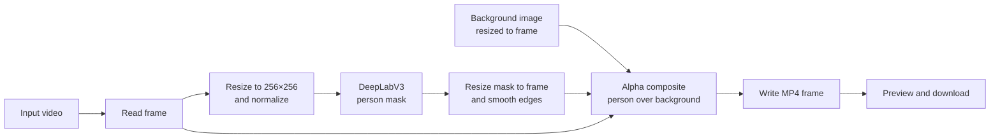

<div align="center">

# 🎬 Video Background Changer

**Replace the background of a recorded video with any image, powered by a fine-tuned DeepLabV3 person segmentation model.**

[](https://background-changer.streamlit.app/)
[](https://huggingface.co/rufaidakassem/deeplabv3_background_segmentation)
[](https://www.python.org/)
[](https://pytorch.org/)
[](LICENSE)

[**Try the app**](https://background-changer.streamlit.app/) · [**Get the model**](https://huggingface.co/rufaidakassem/deeplabv3_background_segmentation) · [**Train your own**](#-train-the-segmentation-model)

</div>

<!-- Add a demo GIF or before/after screenshot here, for example:
<p align="center"></p>
-->

---

## ✨ Features

- 🖼️ **Any background image**: PNG, JPG/JPEG, WEBP, and BMP.
- 🎥 **Common video formats**: MP4, MOV, AVI, MKV, and WEBM.
- 🧍 **Person segmentation**: a fine-tuned DeepLabV3 (ResNet-50) binary model separates the person from the original background, then composites them over your chosen image.
- 🪄 **Soft edges**: the mask is blended with alpha (not a hard cut-out) and slightly blurred, so edges look natural instead of jagged.
- 📊 **Progress tracking**: see processing progress while your video is rendered.
- ⬇️ **Preview and download**: watch the result in the app and save it as an MP4.
- ⚡ **GPU when available**: uses CUDA if present, otherwise falls back to CPU.
- 🧪 **Reproducible training**: a full pipeline to fine-tune DeepLabV3 and export it as TorchScript.

## 🧠 How it works



For every frame the app:

1. Resizes it to 256×256 and normalizes it with ImageNet statistics.
2. Runs the TorchScript model and applies a sigmoid to get a per-pixel person probability.
3. Resizes the mask back to the frame size and smooths it with a Gaussian blur.
4. Blends the frame and the background: `output = frame × mask + background × (1 − mask)`.

### Model details

| Item           | Value                                                                                      |
| -------------- | ------------------------------------------------------------------------------------------ |
| Architecture   | DeepLabV3 with a ResNet-50 backbone (torchvision), pretrained weights, 1-channel head      |
| Task           | Binary segmentation (person vs. background)                                                |
| Input size     | 256 × 256, ImageNet mean/std normalization                                                 |
| Loss           | `BCEWithLogitsLoss`                                                                        |
| Optimizer      | Adam, learning rate `1e-4`                                                                 |
| Training setup | 85/15 train/validation split, up to 15 epochs, early stopping (patience 3)                 |
| Export         | Best validation checkpoint saved as a TorchScript file                                     |
| Dataset        | [Supervisely filtered person segmentation](https://www.kaggle.com/datasets/tapakah68/supervisely-filtered-segmentation-person-dataset) |

---

## ⚠️ Limitations

- The processed video **does not include the original audio**.
- **CPU processing can be slow** for longer videos. Use a CUDA-enabled PyTorch build if you have a GPU.
- Each frame is segmented **independently** (no temporal smoothing), so edges can shimmer slightly on fast motion or busy scenes.
- The model is trained for **people only**; other foreground objects are treated as background.
- If a video can't be decoded, try re-encoding it as an **MP4 (H.264)**.

---

## 🚀 Quick start

### 1. Clone and install

```bash
git clone https://github.com/Rufaida-Kassem/background_changer.git
cd background_changer
```

Install PyTorch for your platform first (choose a CUDA-enabled build if your machine supports it, and install a compatible `torchvision` alongside it), then the remaining requirements:

```bash
python -m pip install torch torchvision
python -m pip install -r requirements.txt
```

### 2. Get the model

The trained model is excluded from Git. It is hosted on Hugging Face:
**[rufaidakassem/deeplabv3_background_segmentation](https://huggingface.co/rufaidakassem/deeplabv3_background_segmentation)**

Choose one of the options below.

**Option A: load it from Hugging Face (recommended).** The model is downloaded and cached on first use. No token is needed for a public repository.

<details open>
<summary>Windows (PowerShell)</summary>

```powershell
$env:MODEL_REPO_ID = "rufaidakassem/deeplabv3_background_segmentation"
python -m streamlit run src/app.py
```

</details>

<details>
<summary>macOS / Linux</summary>

```bash
export MODEL_REPO_ID="rufaidakassem/deeplabv3_background_segmentation"
python -m streamlit run src/app.py
```

</details>

**Option B: use a local file.** Download `deeplabv3_background_segmentation.pt` and place it at `model/deeplabv3_background_segmentation.pt`. If `MODEL_REPO_ID` is not set, the app looks there by default.

### 3. Run the app

```bash
python -m streamlit run src/app.py
```

Open the local URL printed by Streamlit, upload a background image and a video, click **Replace background**, then preview or download the processed MP4.

### ☁️ Deploying on Streamlit Community Cloud

In your app's **Settings → Secrets**, add:

```toml
MODEL_REPO_ID = "rufaidakassem/deeplabv3_background_segmentation"
```

---

## 🏋️ Train the segmentation model

Training uses the [Supervisely filtered person segmentation dataset](https://www.kaggle.com/datasets/tapakah68/supervisely-filtered-segmentation-person-dataset). Download and extract it locally; it is not included in this repository.

```bash
python src/pipeline.py --dataset-root path/to/dataset
```

By default, the pipeline discovers matching image and mask files by normalized filename. Files with `mask` in their path or name are treated as masks, and paths containing `collage` are ignored when discovering images. If automatic discovery doesn't match your layout, pass the directories explicitly:

```bash
python src/pipeline.py \
  --dataset-root path/to/dataset \
  --images-dir path/to/dataset/images \
  --masks-dir path/to/dataset/masks
```

The pipeline:

1. Checks sampled masks and image/mask pairs.
2. Splits the data into training and validation sets.
3. Fine-tunes DeepLabV3 (CUDA is used when available).
4. Exports the best validation model as TorchScript to `model/deeplabv3_background_segmentation.pt`.

<details>
<summary><b>Training arguments</b></summary>

| Argument          | Default                                      | Description                                                 |
| ----------------- | -------------------------------------------- | ----------------------------------------------------------- |
| `--output`        | `model/deeplabv3_background_segmentation.pt` | Output TorchScript model path                               |
| `--epochs`        | `15`                                         | Maximum number of training epochs                           |
| `--batch-size`    | `16`                                         | Batch size                                                  |
| `--learning-rate` | `0.0001`                                     | Adam optimizer learning rate                                |
| `--patience`      | `3`                                          | Validation epochs without improvement before early stopping |
| `--num-workers`   | `2`                                          | Data-loader worker processes                                |
| `--sample-size`   | `100`                                        | Number of image/mask pairs sampled for mask checks          |
| `--seed`          | `42`                                         | Random seed                                                 |
| `--no-pretrained` | Off                                          | Initialize without pretrained DeepLabV3 weights             |

Run `python src/pipeline.py --help` for the full command-line help.

</details>

### Sharing your trained model

To host a model on Hugging Face, upload `deeplabv3_background_segmentation.pt` to a model repository and point `MODEL_REPO_ID` at it.

---

## 📁 Repository layout

| Path                        | Purpose                                                           |
| --------------------------- | ----------------------------------------------------------------- |
| `src/app.py`                | Streamlit user interface and video processing                     |
| `src/utils.py`              | Model loading, person-mask prediction, and background compositing |
| `src/pipeline.py`           | Training command-line entry point                                 |
| `src/segmentation_model.py` | DeepLabV3 model definition                                        |
| `src/training_data.py`      | Dataset discovery, mask checks, and preprocessing                 |
| `src/trainer.py`            | Training loop, validation, and TorchScript export                 |
| `notebook/`                 | Colab notebook with the original training experiments             |
| `model/`                    | Locally generated segmentation model (not tracked by Git)         |
| `data/`                     | Local input data (not tracked by Git)                             |
| `outputs/`                  | Local processed videos and results (not tracked by Git)           |

## 🛠️ Built with

[PyTorch](https://pytorch.org/) · [torchvision (DeepLabV3)](https://pytorch.org/vision/) · [OpenCV](https://opencv.org/) · [NumPy](https://numpy.org/) · [Streamlit](https://streamlit.io/) · [Hugging Face Hub](https://huggingface.co/)

## 📄 License

Distributed under the [MIT License](LICENSE).

## 👩‍💻 Author

**Rufaida Kassem**: [GitHub](https://github.com/Rufaida-Kassem)